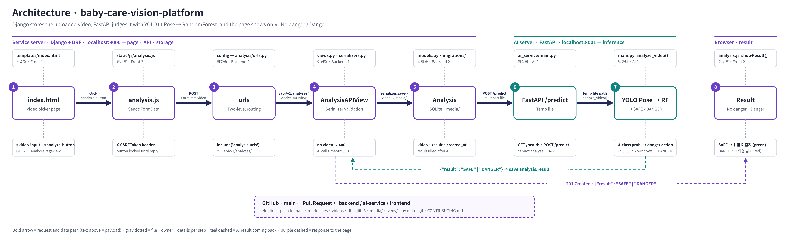
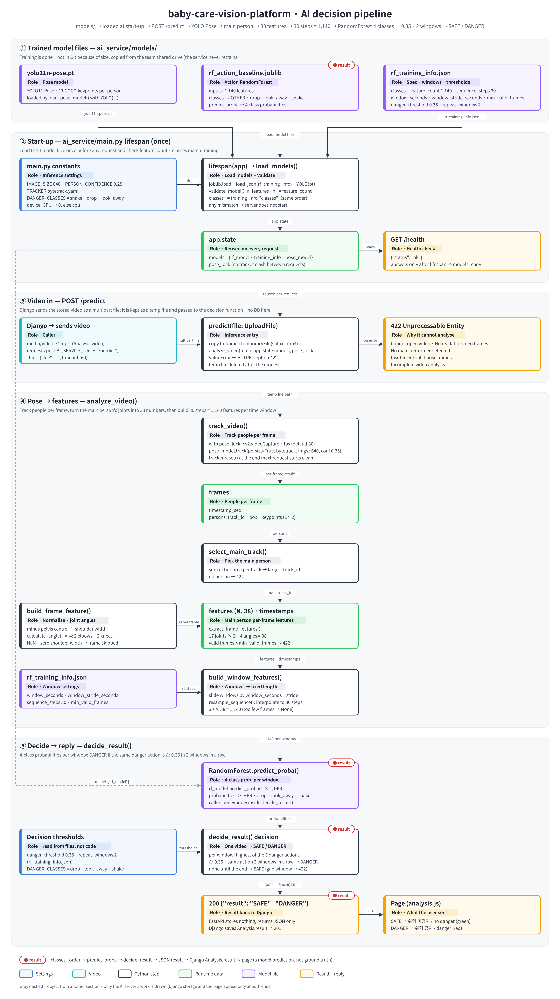
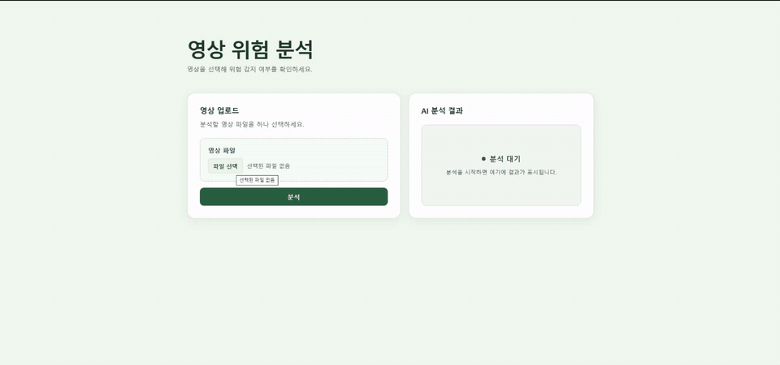
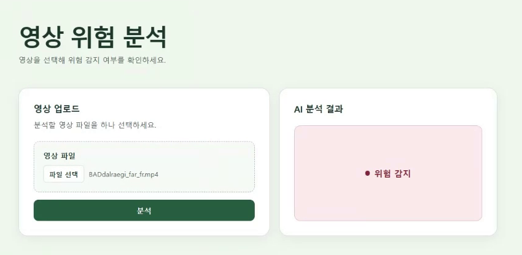
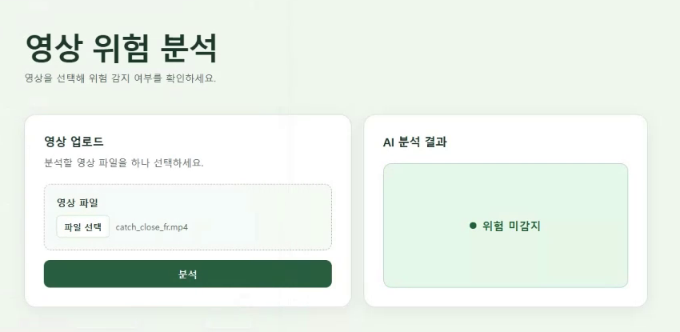
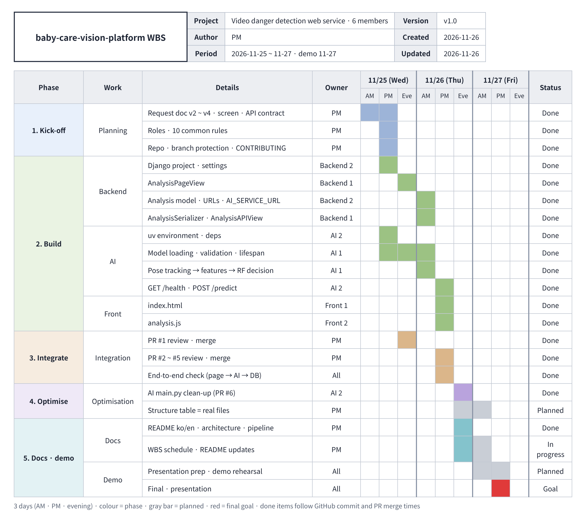

<div align="center">

# Baby Care Vision Platform

**Upload a video and the AI tells you only one thing: "No danger" or "Danger" · Django / DRF · FastAPI · YOLO11 Pose**

</div>

<p align="right"><a href="README.md">한국어</a> | <b>English</b></p>

<p align="center">
      <br>
      
</p>

<br>

## Overview

Pick one video and press **[분석] (Analyse)**. The AI analyses the person's movement and the page shows only **"위험 미감지" (no danger, green) or "위험 감지" (danger, red)**. We kept the feature set to this one flow and spent the effort on a production-style service structure.

- **Service server (Django + DRF · :8000)** — page · REST API · input validation · stores the video and the result
- **AI server (FastAPI · :8001)** — video → YOLO11 Pose → RandomForest → `SAFE` / `DANGER`. It never touches the DB and only returns JSON.
- Six members work on part branches (`backend` · `ai-service` · `frontend`) and **merge into `main` only through PRs.**

<br>

### Architecture

The browser sends the video as `FormData`. Django validates it with a Serializer, saves it, and forwards the saved file to FastAPI `/predict`. Django records the returned `{"result": ...}` and replies **201**, and the page shows the result.



*① → ⑧ from request to screen · text above each arrow is the payload, top cards are file · owner, bottom cards are details. Teal dashed = AI result coming back, purple dashed = response to the page.*

| Server | Role | Design points |
|---|---|---|
| Django `:8000` | Page (`GET /`) · analysis API (`POST /api/v1/analyses/`) · storage | Two class-based views · Serializer validation · AI address in `settings.AI_SERVICE_URL` · 60 s call timeout |
| FastAPI `:8001` | Health (`GET /health`) · decision (`POST /predict`) | Loads 3 model files (`.joblib` · `rf_training_info.json` · `.pt`) once in lifespan · checks feature count · classes · no DB |

<br>

### Pipeline

How the AI server (FastAPI) turns one video into `SAFE` / `DANGER`: model files → loaded once at start-up → `/predict` → pose tracking → 1,140 features → RandomForest → decision. Each box names the real function and its role.



<br>

### Results

| Area | Result |
|---|---|
| API contract | All 4 contracts implemented — Django `GET /` · `POST /api/v1/analyses/`, FastAPI `GET /health` · `POST /predict` |
| Collaboration | 3 part branches → PR #1 ~ #6 reviewed and merged into `main` · direct push to `main` blocked |
| End to end | Page → Django → FastAPI → DB → page confirmed (`wave.mp4` → **위험 미감지 / no danger**) |
| Improvements | Input moved from the view into `AnalysisSerializer` validation · AI address moved to `settings.AI_SERVICE_URL` · `timeout=60` on the AI call · 201 on success · AI `main.py` duplicate code cleaned up (PR #6, same structure · API · results) |

<br>

### Screens



| Danger (`DANGER`) | No danger (`SAFE`) |
|---|---|
|  |  |

*Pick a video → [분석] → "분석 중" (analysing, button locked) → result. Colour and text come from the `data-state` styles in `index.html` and `RESULT_DISPLAY` in `analysis.js`.*

<br>

### API Contract

Change this table first, then the code.

| Server | Request | Sends | Success | Failure |
|---|---|---|---|---|
| Django | `GET /` | — | 200 · `index.html` | — |
| Django | `POST /api/v1/analyses/` | multipart `video` | **201** · `{"result": "SAFE"}` or `{"result": "DANGER"}` | **400** · no `video` (Serializer validation) |
| FastAPI | `GET /health` | — | 200 · `{"status": "ok"}` | — |
| FastAPI | `POST /predict` | multipart `file` | 200 · `{"result": "SAFE"}` or `{"result": "DANGER"}` | **422** · no `file`, unreadable video, no person found, or other cases it cannot analyse |

On screen, `SAFE` → "위험 미감지" and `DANGER` → "위험 감지". The API and code use only these two values.

**Decision rule** · The video is cut into time windows and RandomForest gives 4-class probabilities (`OTHER` · `drop` · `look_away` · `shake`) for each window. If one of the 3 danger actions (`drop` · `look_away` · `shake`) reaches **0.35 or more for the same action in 2 windows in a row**, the result is `DANGER`; otherwise `SAFE`. The thresholds (0.35 · 2 windows · 30 steps · window length) are read from `rf_training_info.json`, not hard-coded.

<br>

### Team

| Name | Role | Owns |
|---|---|---|
| 이성형 (Sung Hyung Lee) | PM · Backend 1 | `views.py` · `serializers.py` · GitHub repository · branch rules · PR review · merge |
| 박하솔 | Backend 2 | `settings.py` · `urls.py` · `models.py` · migration |
| 박하나 | AI 1 | Model loading (lifespan) · decision functions (`analyze_video` · `decide_result`) |
| 이상직 | AI 2 | `GET /health` · `POST /predict` · `main.py` clean-up |
| 김준형 | Front 1 | `templates/index.html` |
| 장세훈 | Front 2 | `static/js/analysis.js` |

<br>

### Schedule (WBS)

The scope is split into phase → work → details, and each detail has an owner and a time slot in a 3-day plan. Done items follow GitHub commit and PR merge times.



<br><br>

## Quick Start

Requirements: Windows 11 + WSL2 Ubuntu · [uv](https://docs.astral.sh/uv/) · runs on CPU (uses a GPU automatically if present).

**Step 1 · Clone and install** — `backend` and `ai_service` use separate virtual environments.

```bash
git clone https://github.com/sunghyunglee/baby-care-vision-platform.git
cd baby-care-vision-platform
(cd backend && uv sync)
(cd ai_service && uv sync)
```

**Step 2 · Place the 4 model files** — they are not in Git because of size. Get them from the team shared drive and put them in `ai_service/models/`.

| File | Purpose |
|---|---|
| `yolo11n-pose.pt` | 17 body keypoints (YOLO11 Pose) |
| `rf_action_baseline.joblib` | 4-action RandomForest |
| `rf_feature_columns.json` | Column order of the 1,140 features (training record · not read by the current `main.py`) |
| `rf_training_info.json` | Classes · windows · decision thresholds |

**Step 3 · ① Start FastAPI (8001)** — keep this terminal open.

```bash
cd ai_service
uv run uvicorn main:app --host 127.0.0.1 --port 8001
```

`Application startup complete.` means the models are loaded.

**Step 4 · ③ Start Django (8000)** — in another terminal.

```bash
cd backend
uv run python manage.py migrate
uv run python manage.py runserver 8000
```

**Step 5 · Check**

```bash
curl http://127.0.0.1:8001/health
# {"status":"ok"}
```

Open http://127.0.0.1:8000/ in a browser, pick a video and press [분석]. To test the API without the page, run `curl -F "video=@sample.mp4" http://127.0.0.1:8000/api/v1/analyses/` (use your own video path); it replies like `{"result":"SAFE"}`.

| Page · API | URL |
|---|---|
| Analysis page | http://127.0.0.1:8000/ |
| Analysis API | http://127.0.0.1:8000/api/v1/analyses/ |
| FastAPI health · docs | http://127.0.0.1:8001/health · http://127.0.0.1:8001/docs |

<br>

## Folder Structure

Exactly the files on `main`. Any new file is shared with the team first, and this table is updated before the code.

```text
baby-care-vision-platform/
├── backend/                  Django + DRF (service server :8000)
│   ├── manage.py
│   ├── pyproject.toml · uv.lock
│   ├── config/               settings.py (AI_SERVICE_URL) · urls.py · asgi.py · wsgi.py
│   ├── analysis/             models.py · serializers.py · views.py · urls.py · apps.py · migrations/
│   ├── templates/index.html  the one page
│   └── static/js/analysis.js sends the request · shows the result
├── ai_service/               FastAPI (AI server :8001)
│   ├── main.py               lifespan model loading · /health · /predict · decision functions
│   ├── pyproject.toml · uv.lock
│   └── models/               4 trained files (not in Git)
├── .gitignore
└── CONTRIBUTING.md
```

`ai_service/models/` (trained files) and Django's `models.py` (DB model) share a name but are different things. Branch · commit · PR · naming rules are in [CONTRIBUTING.md](CONTRIBUTING.md).

<br>

## Limitations · Next Steps

| Item | Details |
|---|---|
| Model accuracy | The training data is small, so results can be wrong for new people, clothing or camera angles. This scope is the **service structure**, not the model. After retraining on more data, only the files in `ai_service/models/` change (a wrong model is rejected by the start-up checks). |
| AI failure | If FastAPI is down or returns 422, Django currently returns **500** → planned: **502** with the reason |
| History | Results are stored in the DB, but there is no list API (`GET /api/v1/analyses/`) yet. |
| Long videos | The request waits for the result (synchronous). Long videos move to **Celery + Redis** async processing. |

<br>

## Notes

- **Model files (`ai_service/models/` · `*.pt` · `*.joblib`), videos (`*.mp4`), `media/`, `db.sqlite3` and `.venv/` are not committed.** They are listed in `.gitignore`.
- If another project already uses **port 8000 or 8001**, startup fails. Stop that server first.
- Development settings (`DEBUG = True`). For production, move `SECRET_KEY` to an environment variable and set `DEBUG = False`.
