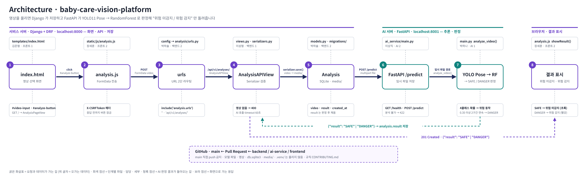
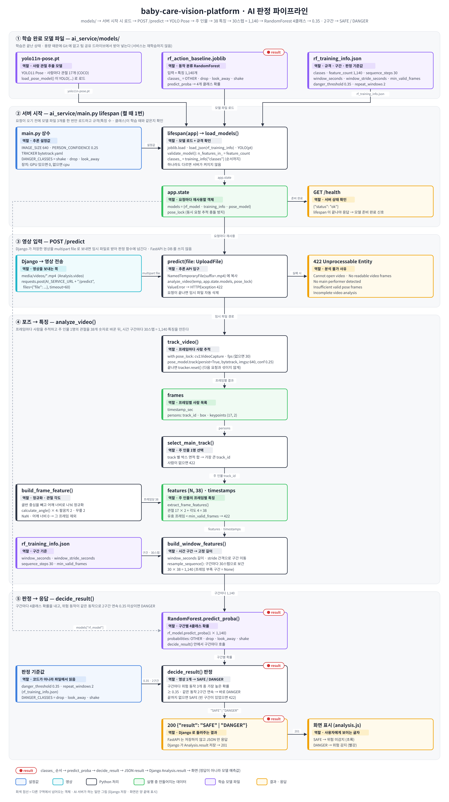
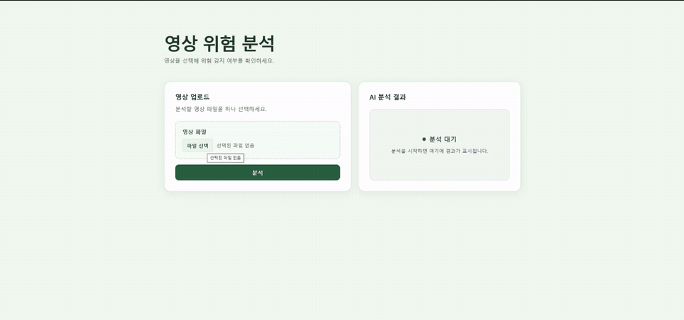
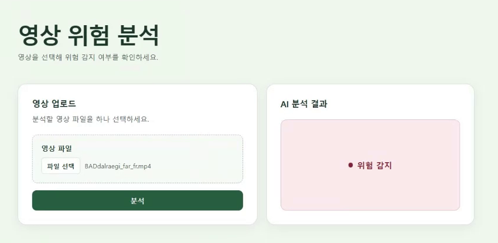
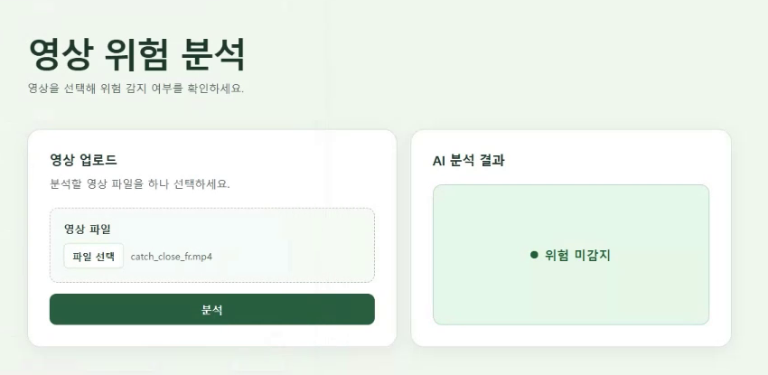
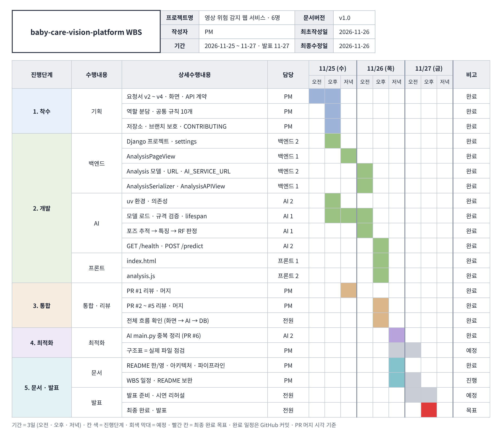

<div align="center">

# Baby Care Vision Platform

**영상을 올리면 AI 가 분석해 「위험 미감지 / 위험 감지」만 알려주는 웹 서비스 · Django / DRF · FastAPI · YOLO11 Pose**

</div>

<p align="right"><b>한국어</b> | <a href="README.en.md">English</a></p>

<p align="center">
      <br>
      
</p>

<br>

## 프로젝트 소개

영상 하나를 고르고 **[분석]** 을 누르면 AI 가 영상 속 사람의 동작을 분석해 **「위험 미감지」(초록) 또는 「위험 감지」(빨강)** 만 보여주는 웹 서비스입니다. 기능은 이것 하나로 좁히고, 그 대신 서비스 구조를 실무 방식으로 나눴습니다.

- **서비스 서버 (Django + DRF · :8000)** — 화면 · REST API · 입력 검증 · 영상과 결과 저장
- **AI 서버 (FastAPI · :8001)** — 영상 → YOLO11 Pose → RandomForest → `SAFE` / `DANGER` 판정. DB 에 접근하지 않고 JSON 만 돌려줍니다.
- 6명이 파트별 브랜치(`backend` · `ai-service` · `frontend`)에서 작업하고 **PR 로만 `main` 에 합칩니다.**

<br>

### Architecture

브라우저가 `FormData` 로 영상을 보내면 Django 가 Serializer 로 검증해 저장하고, 저장한 영상을 FastAPI `/predict` 에 보냅니다. FastAPI 가 돌려준 `{"result": ...}` 를 DB 에 기록한 뒤 **201** 로 응답하면 화면이 결과를 표시합니다.



*① → ⑧ 요청부터 화면까지 · 화살표 위는 오가는 데이터, 위 카드는 파일 · 담당, 아래 카드는 세부 동작입니다. 청록 점선은 AI 판정 결과, 보라 점선은 화면으로 가는 응답입니다.*

| 서버 | 역할 | 설계 포인트 |
|---|---|---|
| Django `:8000` | 화면 (`GET /`) · 분석 API (`POST /api/v1/analyses/`) · 저장 | 클래스 기반 View 2개 · Serializer 검증 · AI 주소는 `settings.AI_SERVICE_URL` · 호출 timeout 60초 |
| FastAPI `:8001` | 상태 확인 (`GET /health`) · 판정 (`POST /predict`) | 모델 3개(`.joblib` · `rf_training_info.json` · `.pt`)를 lifespan 에서 1번만 로드 · 특징 수 · 클래스 검증 · DB 비의존 |

<br>

### Pipeline

AI 서버(FastAPI)가 영상 1개를 `SAFE` / `DANGER` 로 판정하는 과정입니다. 모델 파일 → 서버 시작 시 1번 로드 → `/predict` → 포즈 추적 → 특징 1,140개 → RandomForest → 판정 순서이며, 박스마다 실제 함수 이름과 역할을 적었습니다.



<br>

### 작업 결과

| 구분 | 결과 |
|---|---|
| API 계약 | 계약 4개 구현 — Django `GET /` · `POST /api/v1/analyses/`, FastAPI `GET /health` · `POST /predict` |
| 협업 | 파트 브랜치 3개 → PR #1 ~ #6 리뷰 후 `main` 머지 · `main` 직접 push 차단 |
| 전체 흐름 | 화면 → Django → FastAPI → DB → 화면 연결 확인 (`wave.mp4` → **위험 미감지**) |
| 개선 | View 에서 직접 받던 입력을 `AnalysisSerializer` 검증으로 변경 · AI 주소를 `settings.AI_SERVICE_URL` 로 분리 · AI 호출 `timeout=60` 추가 · 성공 응답 201 · AI `main.py` 중복 정리 (PR #6, 구조 · API · 판정 결과 동일) |

<br>

### 작동 화면



| 위험 감지 (`DANGER`) | 위험 미감지 (`SAFE`) |
|---|---|
|  |  |

*영상 선택 → [분석] → 「분석 중」(버튼 잠금) → 결과. 결과 색과 글자는 `index.html` 의 `data-state` 스타일과 `analysis.js` 의 `RESULT_DISPLAY` 가 정합니다.*

<br>

### API 계약

경로 · 필드 · 값은 이 표를 먼저 고친 뒤 코드를 바꿉니다.

| 서버 | 요청 | 보내는 것 | 성공 | 실패 |
|---|---|---|---|---|
| Django | `GET /` | — | 200 · `index.html` | — |
| Django | `POST /api/v1/analyses/` | multipart `video` | **201** · `{"result": "SAFE"}` 또는 `{"result": "DANGER"}` | **400** · `video` 없음 (Serializer 검증) |
| FastAPI | `GET /health` | — | 200 · `{"status": "ok"}` | — |
| FastAPI | `POST /predict` | multipart `file` | 200 · `{"result": "SAFE"}` 또는 `{"result": "DANGER"}` | **422** · `file` 없음, 영상을 열 수 없음, 사람을 찾지 못함 등 분석 불가 |

화면 글자는 `SAFE` → 「위험 미감지」, `DANGER` → 「위험 감지」 입니다. API · 코드에는 이 두 값만 씁니다.

**판정 기준** · 영상을 시간 구간으로 나눠 구간마다 RandomForest 가 4개 클래스(`OTHER` · `drop` · `look_away` · `shake`) 확률을 냅니다. 위험 동작 3개(`drop` · `look_away` · `shake`) 중 하나가 **0.35 이상으로 같은 동작이 2구간 연속** 나오면 `DANGER`, 끝까지 없으면 `SAFE` 입니다. 기준값(0.35 · 2구간 · 30스텝 · 구간 길이)은 코드가 아니라 `rf_training_info.json` 에서 읽습니다.

<br>

### 팀원 소개

| 이름 | 역할 | 담당 |
|---|---|---|
| 이성형 | PM · 백엔드 1 | `views.py` · `serializers.py` · GitHub 저장소 · 브랜치 규칙 · PR 리뷰 · 머지 |
| 박하솔 | 백엔드 2 | `settings.py` · `urls.py` · `models.py` · migration |
| 박하나 | AI 1 | 모델 로드 (lifespan) · 판정 함수 (`analyze_video` · `decide_result`) |
| 이상직 | AI 2 | `GET /health` · `POST /predict` · `main.py` 코드 정리 |
| 김준형 | 프론트 1 | `templates/index.html` |
| 장세훈 | 프론트 2 | `static/js/analysis.js` |

<br>

### 일정 (WBS)

범위를 진행단계 → 수행내용 → 상세수행내용으로 나누고, 상세수행내용마다 담당 · 기간을 정해 3일 일정으로 관리했습니다. 완료 칸은 GitHub 커밋 · PR 머지 시각 기준입니다.



<br><br>

## 빠른 시작

요구 환경: Windows 11 + WSL2 Ubuntu · [uv](https://docs.astral.sh/uv/) · GPU 없이 CPU 로 동작합니다 (GPU 가 있으면 자동 사용).

**1단계 · 받기 · 설치** — `backend` 와 `ai_service` 는 가상환경을 따로 씁니다.

```bash
git clone https://github.com/sunghyunglee/baby-care-vision-platform.git
cd baby-care-vision-platform
(cd backend && uv sync)
(cd ai_service && uv sync)
```

**2단계 · 모델 파일 4개 배치** — 용량 때문에 Git 에 없습니다. 팀 공유 드라이브에서 받아 `ai_service/models/` 에 넣습니다.

| 파일 | 용도 |
|---|---|
| `yolo11n-pose.pt` | 사람 관절 17개 추출 (YOLO11 Pose) |
| `rf_action_baseline.joblib` | 4개 동작 RandomForest |
| `rf_feature_columns.json` | 특징 1,140개 컬럼 순서 (학습 기록용 · 현재 `main.py` 는 읽지 않음) |
| `rf_training_info.json` | 클래스 · 구간 · 판정 기준값 |

**3단계 · ① FastAPI 실행 (8001)** — 터미널 하나를 켜 둡니다.

```bash
cd ai_service
uv run uvicorn main:app --host 127.0.0.1 --port 8001
```

`Application startup complete.` 가 나오면 모델 로드까지 끝난 것입니다.

**4단계 · ③ Django 실행 (8000)** — 다른 터미널에서 실행합니다.

```bash
cd backend
uv run python manage.py migrate
uv run python manage.py runserver 8000
```

**5단계 · 확인**

```bash
curl http://127.0.0.1:8001/health
# {"status":"ok"}
```

브라우저에서 http://127.0.0.1:8000/ 을 열고 영상을 골라 [분석] 을 누릅니다. 화면 없이 API 만 확인할 때는 `curl -F "video=@sample.mp4" http://127.0.0.1:8000/api/v1/analyses/` (영상 경로는 본인 파일) 를 실행하면 `{"result":"SAFE"}` 처럼 응답합니다.

| 화면 · API | 주소 |
|---|---|
| 분석 화면 | http://127.0.0.1:8000/ |
| 분석 API | http://127.0.0.1:8000/api/v1/analyses/ |
| FastAPI 상태 · 문서 | http://127.0.0.1:8001/health · http://127.0.0.1:8001/docs |

<br>

## 폴더 구조

`main` 의 실제 파일 그대로입니다. 구조표에 없는 파일은 팀 공유 후 이 표부터 고칩니다.

```text
baby-care-vision-platform/
├── backend/                  Django + DRF (서비스 서버 :8000)
│   ├── manage.py
│   ├── pyproject.toml · uv.lock
│   ├── config/               settings.py (AI_SERVICE_URL) · urls.py · asgi.py · wsgi.py
│   ├── analysis/             models.py · serializers.py · views.py · urls.py · apps.py · migrations/
│   ├── templates/index.html  화면 1장
│   └── static/js/analysis.js 요청 전송 · 결과 표시
├── ai_service/               FastAPI (AI 서버 :8001)
│   ├── main.py               lifespan 모델 로드 · /health · /predict · 판정 함수
│   ├── pyproject.toml · uv.lock
│   └── models/               학습 완료 파일 4개 (Git 제외)
├── .gitignore
└── CONTRIBUTING.md
```

`ai_service/models/` (학습 파일 폴더) 와 Django 의 `models.py` (DB 모델) 는 이름만 같고 다른 것입니다. 브랜치 · 커밋 · PR · 이름 규칙은 [CONTRIBUTING.md](CONTRIBUTING.md) 를 따릅니다.

<br>

## 한계 · 향후 계획

| 항목 | 내용 |
|---|---|
| 모델 성능 | 학습 데이터가 적어 처음 보는 사람 · 옷 · 촬영 각도에서는 판정이 틀릴 수 있습니다. 이번 범위는 모델 개선이 아니라 **서비스 구조**이며, 데이터를 늘려 재학습한 뒤 `ai_service/models/` 파일만 바꾸면 됩니다 (잘못된 모델은 기동 단계 검증에서 막힘). |
| AI 실패 처리 | FastAPI 가 꺼져 있거나 422 를 돌려주면 Django 는 지금 **500** 을 냅니다 → **502** 와 실패 사유로 응답하도록 개선 예정 |
| 기록 조회 | 분석 결과는 DB 에 쌓이지만 조회 API (`GET /api/v1/analyses/`) 는 아직 없습니다. |
| 긴 영상 | 지금은 응답까지 기다리는 동기 처리입니다. 긴 영상은 **Celery + Redis 비동기** 로 확장합니다. |

<br>

## 주의사항

- **모델 파일 (`ai_service/models/` · `*.pt` · `*.joblib`) · 영상 (`*.mp4`) · `media/` · `db.sqlite3` · `.venv/` 는 Git 에 올리지 않습니다.** `.gitignore` 에 등록되어 있습니다.
- 다른 프로젝트가 **8000 · 8001 포트**를 쓰고 있으면 실행이 충돌합니다. 먼저 그 서버를 끄고 실행합니다.
- 개발용 설정입니다 (`DEBUG = True`). 운영 환경에서는 `SECRET_KEY` 를 환경 변수로 빼고 `DEBUG = False` 로 바꿉니다.
